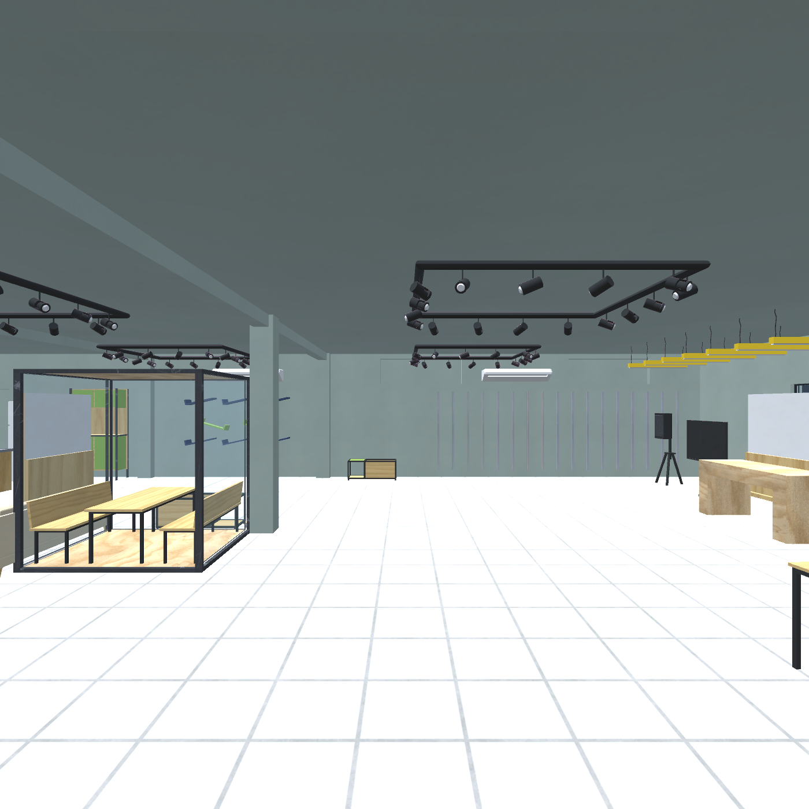

# Missão Estágio — Sebrae Lab VR

Experiência em realidade virtual em que o visitante conhece o Sebrae Lab no papel de um estagiário em seu primeiro dia: explora o espaço, conversa com o gestor e recebe pequenas missões.

**Em desenvolvimento:** ambiente 3D montado e primeira missão implementada no Unity. A validação no Quest real ainda não foi registrada. O APK da missão do gerente ainda não foi gerado.

## Comece por aqui

1. Instale **Unity 6000.0.83f1** pelo Unity Hub.
2. Clone o repositório:

~~~bash
git clone https://github.com/diegovitor90/sebrae_unity.git
cd sebrae_unity
~~~

3. No Unity Hub, adicione a pasta que contém **Assets, Packages e ProjectSettings**. Aguarde a importação e a compilação.
4. No menu superior do editor, abra **Sebrae Lab → Missao 01 → 2 - Abrir missao do gerente**.
5. Para teclado e mouse, pare o Play, ative **Sebrae Lab → 4 - Alternar simulador PC** e clique em **▶ Play**.

O menu **Sebrae Lab** fica na barra superior, junto de File, Edit e Window. Ele não é a pasta da janela Project.

[Instalação e primeiros testes](docs/COMECE_AQUI.md) · [Índice da documentação](docs/README.md)

## O que já foi feito

| Entrega | Situação comprovada | Próxima validação |
| --- | --- | --- |
| Ambiente 3D | Modelos importados, mobiliário organizado, materiais/texturas aplicados, escala métrica preservada e colisões configuradas | Escala percebida, percursos e desempenho no Quest |
| Base VR | Jogador, controles, teletransporte, giro em passos e simulador de PC configurados | Rastreamento e interação com controles reais |
| Sala de testes | Cubo para pegar/soltar e botão com resposta visual | Operação no headset |
| Gerente → conversa → encontrar a sala | NPC estilizado, diálogo, aceite, percurso sinalizado, conclusão e reinício | APK desta cena e teste no Quest |
| Versionamento | Projeto completo integrado à main, com arquivos .meta e guias | Novas entregas por branch e pull request |

A missão passou por **11 verificações de fluxo em Play Mode**. Elas verificam a lógica e os callbacks dos botões; não substituem apontar, apertar o gatilho e se locomover com o Quest real.

## Cenas

| Cena | Finalidade | Menu para abrir |
| --- | --- | --- |
| SebraeLab_MissaoGerente.unity | Primeira missão: encontrar gestor, conversar e localizar a sala | Sebrae Lab → Missao 01 → 2 - Abrir missao do gerente |
| SebraeLab_Exploracao.unity | Ambiente de exploração sem a missão | Sebrae Lab → Ambiente → 2 - Abrir ambiente |
| VR_Test.unity | Testes isolados de objetos e interface | Sebrae Lab → 2 - Abrir cena de teste |

Arquivos em [Assets/SebraeLab/Scenes](Assets/SebraeLab/Scenes). A cena da missão está selecionada nas configurações de build versionadas.

## Missões do roteiro

| Etapa | Estado atual |
| --- | --- |
| **1. Busca pelo gerente** — encontrar → conversar → receber missão | Implementada no Unity |
| **2. A própria sala** — encontrar → agarrar maçaneta → abrir porta | Chegada e conclusão implementadas; maçaneta e abertura interativa pendentes |
| **3. Mural do Conhecimento** — apontar → ler → “Entendido” | Pendente |
| **4. Café de sobrevivência** — encontrar a copa → pegar café | Pendente; a copa pode ser reaproveitada |
| **5. Faz-tudo** — guardar livros → endireitar cadeiras → posicionar notebooks → aviso final | Pendente; há modelos de cadeiras, mas falta a interação e a validação |

Boliche e arco e flecha são atividades planejadas, ainda não implementadas. A equipe precisa definir se entram na entrega principal ou como extras.

O status descreve entregas verificáveis, sem percentuais de esforço. [Backlog e critérios de conclusão](docs/ROADMAP.md).

## APKs e distribuição

| Arquivo | Conteúdo | Situação |
| --- | --- | --- |
| SebraeLabVR.apk | Sala de testes | Gerado localmente; assinatura verificada |
| SebraeLab-Ambiente.apk | Ambiente de exploração | Gerado localmente; assinatura verificada |
| SebraeLab-MissaoGerente.apk | Ambiente com a primeira missão | Ainda não gerado |

**Os APKs não estão no repositório e ainda não há GitHub Release publicada.** As builds existentes ficaram na máquina de desenvolvimento, na pasta Builds/Quest/. Clonar o projeto não baixa um aplicativo pronto.

Os APKs existentes foram produzidos antes da missão e não a incluem. Todas as builds usam **com.sebraelab.missaoestagio**: instalar uma versão substitui a anterior no dispositivo.

[Como gerar e instalar a build correta](docs/COMECE_AQUI.md#gerar-o-apk-correto). Builds aprovadas poderão ser distribuídas por GitHub Releases.

## Organização

~~~text
Assets/
├── SebraeLab/       # Cenas, scripts, materiais, ambiente e missão
├── Sebraelab3D/     # 27 modelos FBX e quatro texturas originais
├── Samples/         # Exemplos do XR Interaction Toolkit
├── XR/              # Configurações OpenXR
└── XRI/             # Configurações de interação
Packages/            # Dependências e versões fixadas
ProjectSettings/     # Configurações e versão do Unity
Previews/            # Imagens do ambiente para revisão
docs/                # Guias, status e testes
.github/             # Modelos de issue e pull request
SebraeLabUnityAssets.unitypackage  # Pacote original preservado
~~~

[Arquitetura, prefabs, modelos e colisões](docs/ESTRUTURA.md). Caches, logs, preferências locais, ferramentas Android e builds ficam fora do Git.

## Base técnica

- **Unity 6000.0.83f1**, com alvo Meta Quest 3/3S.
- **XR Interaction Toolkit 3.0.11**, **OpenXR 1.16.1** e **Input System 1.19.0**.
- Android **ARM64 / IL2CPP**, Vulkan, API mínima **32** e alvo **35**.
- Texturas Android ASTC 6×6 com mipmaps; atlas até 2048 e demais texturas até 1024.

As dependências são controladas por [manifest.json](Packages/manifest.json) e [packages-lock.json](Packages/packages-lock.json). As ferramentas Android devem ser configuradas em cada computador.

## Documentação e equipe

- [Abrir e testar o projeto](docs/COMECE_AQUI.md)
- [Verificações realizadas e roteiro de testes](docs/TESTES.md)
- [Detalhes da primeira missão](docs/MISSAO_GERENTE.md)
- [Roadmap e próximas entregas](docs/ROADMAP.md)
- [Como contribuir](CONTRIBUTING.md)
- [Aprender Git e GitHub](docs/VERSIONAMENTO.md)
- [Papéis propostos para a equipe](docs/EQUIPE.md)

Use as [Issues](https://github.com/diegovitor90/sebrae_unity/issues) para registrar falhas e tarefas. Informe sempre a cena e se o resultado foi verificado no editor ou no Quest.
